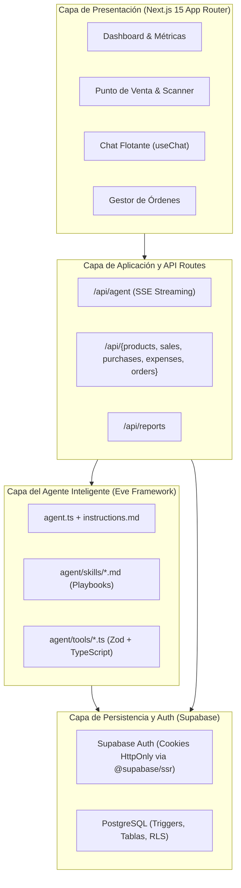

# 00-overview / plan.md — Plan Técnico y Arquitectura Global

## 1. Arquitectura de Alto Nivel

El sistema se estructura en 4 capas desacopladas:



## 2. Stack Tecnológico

| Capa | Herramienta | Versión / Justificación |
|---|---|---|
| **Framework Base** | Next.js | 15+ (App Router con Server Components y Server Actions) |
| **Estilos & UI** | Tailwind CSS + shadcn/ui | Interfaz limpia, accesible y de renderizado veloz |
| **Visualización** | Recharts | Renderizado declarativo y reactivo para gráficas de barras y líneas |
| **Escáner Barcode** | @ericblade/quagga2 | Librería moderna para captura EAN-13 vía WebRTC en navegador |
| **Framework Agente** | Eve (Vercel) / Vercel AI SDK | Enfoque filesystem-first con herramientas tipadas en Zod |
| **Modelo LLM** | OpenAI GPT-4o-mini | Óptimo en latencia, costo y razonamiento para tareas analíticas |
| **BaaS / Base de Datos**| Supabase (PostgreSQL 15) | Triggers para integridad de inventario, RLS y Auth integrado |
| **Exportación** | jsPDF + SheetJS (xlsx) | Generación en cliente sin recargar el servidor |
| **Lenguaje** | TypeScript | Modo estricto (`strict: true`) en todo el proyecto |

## 3. Estructura de Directorios del Repositorio

```
agente-bodega/
├── agent/                     # Runtime del agente Eve
│   ├── agent.ts               # Configuración de modelo y parámetros
│   ├── instructions.md        # Prompt del sistema principal
│   ├── skills/                # Playbooks dinámicos en Markdown
│   └── tools/                 # Herramientas ejecutables en TypeScript
├── app/                       # Rutas Next.js App Router
│   ├── api/                   # Handlers REST y Streaming
│   ├── dashboard/             # Módulos del dashboard privado
│   ├── login/                 # Autenticación
│   ├── layout.tsx             # Layout global
│   └── page.tsx               # Redirección raíz
├── components/                # Componentes React modulares
│   ├── chat/                  # Interfaz de conversación y mensajes
│   ├── dashboard/             # Tarjetas de KPI y gráficas
│   ├── pos/                   # Escáner y formulario de venta
│   └── orders/                # Tarjetas y acciones de compra
├── lib/                       # Utilidades transversales
│   ├── supabase/              # Clientes Browser, Server y Admin
│   └── utils/                 # Algoritmos matemáticos y exportación
├── specs/                     # Especificaciones SDD modulares
└── supabase/                  # Migraciones SQL y datos de prueba
```
