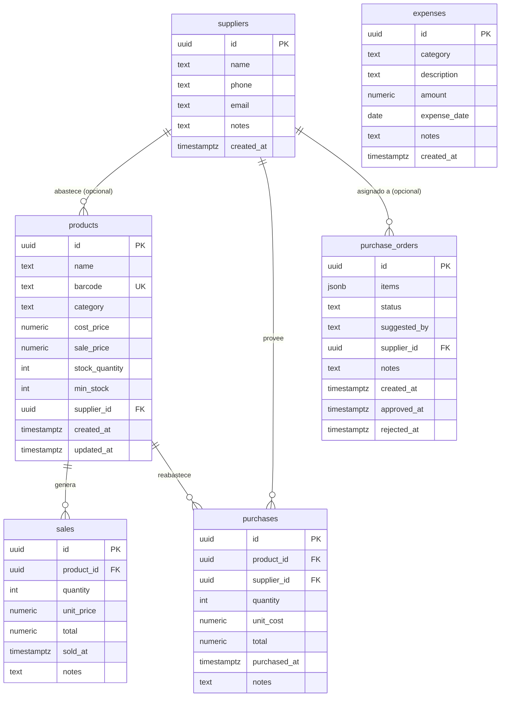

# 01-database / plan.md — Plan Técnico DDL, Triggers, RLS y Seed

## 1. Diagrama Entidad-Relación



## 2. Definición DDL y Triggers en PostgreSQL

### 2.1 Tablas Principales
```sql
-- Habilitar extensión UUID
CREATE EXTENSION IF NOT EXISTS "pgcrypto";

-- Proveedores
CREATE TABLE IF NOT EXISTS suppliers (
  id          uuid PRIMARY KEY DEFAULT gen_random_uuid(),
  name        text NOT NULL,
  phone       text,
  email       text,
  notes       text,
  created_at  timestamptz NOT NULL DEFAULT now()
);

-- Productos
CREATE TABLE IF NOT EXISTS products (
  id              uuid PRIMARY KEY DEFAULT gen_random_uuid(),
  name            text NOT NULL,
  barcode         text UNIQUE,
  category        text NOT NULL DEFAULT 'Abarrotes',
  cost_price      numeric(10,2) NOT NULL CHECK (cost_price >= 0),
  sale_price      numeric(10,2) NOT NULL CHECK (sale_price >= 0),
  stock_quantity  integer NOT NULL DEFAULT 0 CHECK (stock_quantity >= 0),
  min_stock       integer NOT NULL DEFAULT 5 CHECK (min_stock >= 0),
  supplier_id     uuid REFERENCES suppliers(id) ON DELETE SET NULL,
  created_at      timestamptz NOT NULL DEFAULT now(),
  updated_at      timestamptz NOT NULL DEFAULT now()
);

-- Ventas
CREATE TABLE IF NOT EXISTS sales (
  id          uuid PRIMARY KEY DEFAULT gen_random_uuid(),
  product_id  uuid NOT NULL REFERENCES products(id) ON DELETE RESTRICT,
  quantity    integer NOT NULL CHECK (quantity > 0),
  unit_price  numeric(10,2) NOT NULL CHECK (unit_price >= 0),
  total       numeric(10,2) GENERATED ALWAYS AS (quantity * unit_price) STORED,
  sold_at     timestamptz NOT NULL DEFAULT now(),
  notes       text
);

-- Compras de reposición
CREATE TABLE IF NOT EXISTS purchases (
  id            uuid PRIMARY KEY DEFAULT gen_random_uuid(),
  product_id    uuid NOT NULL REFERENCES products(id) ON DELETE RESTRICT,
  supplier_id   uuid REFERENCES suppliers(id) ON DELETE SET NULL,
  quantity      integer NOT NULL CHECK (quantity > 0),
  unit_cost     numeric(10,2) NOT NULL CHECK (unit_cost >= 0),
  total         numeric(10,2) GENERATED ALWAYS AS (quantity * unit_cost) STORED,
  purchased_at  timestamptz NOT NULL DEFAULT now(),
  notes         text
);

-- Gastos generales
CREATE TABLE IF NOT EXISTS expenses (
  id            uuid PRIMARY KEY DEFAULT gen_random_uuid(),
  category      text NOT NULL,
  description   text NOT NULL,
  amount        numeric(10,2) NOT NULL CHECK (amount > 0),
  expense_date  date NOT NULL DEFAULT CURRENT_DATE,
  notes         text,
  created_at    timestamptz NOT NULL DEFAULT now()
);

-- Órdenes de compra
CREATE TABLE IF NOT EXISTS purchase_orders (
  id            uuid PRIMARY KEY DEFAULT gen_random_uuid(),
  items         jsonb NOT NULL,
  status        text NOT NULL DEFAULT 'pending' CHECK (status IN ('pending', 'approved', 'rejected', 'completed')),
  suggested_by  text NOT NULL DEFAULT 'agent',
  supplier_id   uuid REFERENCES suppliers(id) ON DELETE SET NULL,
  notes         text,
  created_at    timestamptz NOT NULL DEFAULT now(),
  approved_at   timestamptz,
  rejected_at   timestamptz
);
```

### 2.2 Triggers de Actualización Automática de Stock
```sql
-- Trigger para actualizar updated_at
CREATE OR REPLACE FUNCTION set_updated_at()
RETURNS TRIGGER AS $$
BEGIN
  NEW.updated_at = now();
  RETURN NEW;
END;
$$ LANGUAGE plpgsql;

CREATE TRIGGER trg_products_updated_at
  BEFORE UPDATE ON products
  FOR EACH ROW EXECUTE FUNCTION set_updated_at();

-- Trigger: Restar stock en venta
CREATE OR REPLACE FUNCTION fn_reduce_stock_sale()
RETURNS TRIGGER AS $$
BEGIN
  UPDATE products
  SET stock_quantity = stock_quantity - NEW.quantity
  WHERE id = NEW.product_id;
  RETURN NEW;
END;
$$ LANGUAGE plpgsql;

CREATE TRIGGER trg_sales_reduce_stock
  AFTER INSERT ON sales
  FOR EACH ROW EXECUTE FUNCTION fn_reduce_stock_sale();

-- Trigger: Sumar stock en compra
CREATE OR REPLACE FUNCTION fn_increase_stock_purchase()
RETURNS TRIGGER AS $$
BEGIN
  UPDATE products
  SET stock_quantity = stock_quantity + NEW.quantity
  WHERE id = NEW.product_id;
  RETURN NEW;
END;
$$ LANGUAGE plpgsql;

CREATE TRIGGER trg_purchases_increase_stock
  AFTER INSERT ON purchases
  FOR EACH ROW EXECUTE FUNCTION fn_increase_stock_purchase();
```

### 2.3 Políticas de Seguridad (RLS)
```sql
ALTER TABLE suppliers ENABLE ROW LEVEL SECURITY;
ALTER TABLE products ENABLE ROW LEVEL SECURITY;
ALTER TABLE sales ENABLE ROW LEVEL SECURITY;
ALTER TABLE purchases ENABLE ROW LEVEL SECURITY;
ALTER TABLE expenses ENABLE ROW LEVEL SECURITY;
ALTER TABLE purchase_orders ENABLE ROW LEVEL SECURITY;

CREATE POLICY "auth_suppliers" ON suppliers FOR ALL TO authenticated USING (true) WITH CHECK (true);
CREATE POLICY "auth_products" ON products FOR ALL TO authenticated USING (true) WITH CHECK (true);
CREATE POLICY "auth_sales" ON sales FOR ALL TO authenticated USING (true) WITH CHECK (true);
CREATE POLICY "auth_purchases" ON purchases FOR ALL TO authenticated USING (true) WITH CHECK (true);
CREATE POLICY "auth_expenses" ON expenses FOR ALL TO authenticated USING (true) WITH CHECK (true);
CREATE POLICY "auth_orders" ON purchase_orders FOR ALL TO authenticated USING (true) WITH CHECK (true);
```
