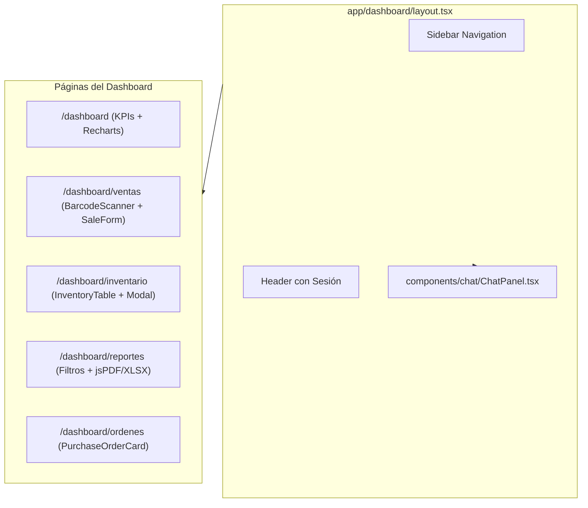

# 05-ui-dashboard / plan.md — Plan Técnico de Componentes, Vistas y Exportación

## 1. Arquitectura de Componentes de Frontend

## 2. Definición Técnica de Componentes Clave

### 2.1 `BarcodeScanner.tsx` (`components/pos/BarcodeScanner.tsx`)
- Utiliza `@ericblade/quagga2`.
- Solicita permiso de cámara mediante `navigator.mediaDevices.getUserMedia`.
- Configurado para decodificar formato `ean_reader`.
- Al detectar un código válido, emite `onDetected(code)` y activa una señal háptica/sonora breve de confirmación.

### 2.2 `ChatPanel.tsx` (`components/chat/ChatPanel.tsx`)
- Implementa `useChat` de `@ai-sdk/react` con endpoint configurado a `/api/agent`.
- Mantiene scroll automático al fondo durante la generación de texto.
- Renderiza Markdown con soporte de tablas y listas usando componentes Tailwind.

### 2.3 `SalesChart.tsx` (`components/dashboard/SalesChart.tsx`)
- Renderiza componentes `ResponsiveContainer`, `LineChart`, `Line`, `XAxis`, `YAxis`, `Tooltip` y `CartesianGrid` de `recharts`.
- Formateo de tooltips localizado al español (fechas y moneda con separador de miles).

### 2.4 Módulo de Exportación (`lib/utils/export.ts`)
- **PDF**: Implementado con `jspdf` y `jspdf-autotable`. Genera cabecera con datos de la tienda, período consultado y tablas estructuradas.
- **Excel**: Implementado con `xlsx` (`SheetJS`). Genera un archivo `.xlsx` estructurado por hojas limpias sin dependencias de servidor.

## 3. Estados Visuales y Manejo de Errores
- Skeleton screens (`<Skeleton className="..." />`) en todas las cargas iniciales de KPIs y tablas.
- Mensajes Toast (mediante `sonner` o `shadcn/ui toast`) para confirmaciones de venta, aprobación de orden y errores de validación.
