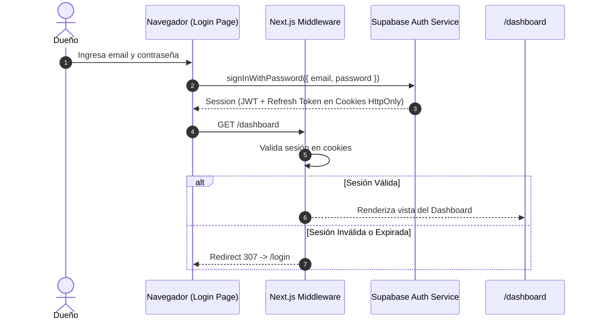

# 06-auth-security / plan.md — Plan Técnico de Autenticación, Middleware y Clientes

## 1. Arquitectura de Sesiones SSR

Se implementa el patrón oficial de Supabase con `@supabase/ssr` para Next.js App Router, gestionando tokens de acceso y refresco en cookies seguras `HttpOnly`, `SameSite=Lax`.



## 2. Clientes de Supabase (`lib/supabase/`)

### 2.1 Cliente del Navegador (`lib/supabase/client.ts`)
```typescript
import { createBrowserClient } from "@supabase/ssr";

export function createClient() {
  return createBrowserClient(
    process.env.NEXT_PUBLIC_SUPABASE_URL!,
    process.env.NEXT_PUBLIC_SUPABASE_ANON_KEY!
  );
}
```

### 2.2 Cliente del Servidor (`lib/supabase/server.ts`)
```typescript
import { createServerClient } from "@supabase/ssr";
import { cookies } from "next/headers";

export async function createClient() {
  const cookieStore = await cookies();
  return createServerClient(
    process.env.NEXT_PUBLIC_SUPABASE_URL!,
    process.env.NEXT_PUBLIC_SUPABASE_ANON_KEY!,
    {
      cookies: {
        getAll() {
          return cookieStore.getAll();
        },
        setAll(cookiesToSet) {
          try {
            cookiesToSet.forEach(({ name, value, options }) =>
              cookieStore.set(name, value, options)
            );
          } catch {
            // Manejado en Server Components de solo lectura
          }
        },
      },
    }
  );
}
```

### 2.3 Cliente Administrativo (`lib/supabase/admin.ts`)
```typescript
import { createClient } from "@supabase/supabase-js";

export const supabaseAdmin = createClient(
  process.env.NEXT_PUBLIC_SUPABASE_URL!,
  process.env.SUPABASE_SERVICE_ROLE_KEY!,
  { auth: { persistSession: false, autoRefreshToken: false } }
);
```

## 3. Middleware de Protección (`middleware.ts`)

```typescript
import { createServerClient } from "@supabase/ssr";
import { NextResponse, type NextRequest } from "next/server";

export async function middleware(request: NextRequest) {
  let response = NextResponse.next({
    request: { headers: request.headers },
  });

  const supabase = createServerClient(
    process.env.NEXT_PUBLIC_SUPABASE_URL!,
    process.env.NEXT_PUBLIC_SUPABASE_ANON_KEY!,
    {
      cookies: {
        getAll() {
          return request.cookies.getAll();
        },
        setAll(cookiesToSet) {
          cookiesToSet.forEach(({ name, value }) =>
            request.cookies.set(name, value)
          );
          response = NextResponse.next({ request });
          cookiesToSet.forEach(({ name, value, options }) =>
            response.cookies.set(name, value, options)
          );
        },
      },
    }
  );

  const { data: { user } } = await supabase.auth.getUser();

  const isAuthRoute = request.nextUrl.pathname === "/login";
  const isProtectedRoute = request.nextUrl.pathname.startsWith("/dashboard") ||
                           request.nextUrl.pathname.startsWith("/api/agent");

  if (!user && isProtectedRoute) {
    return NextResponse.redirect(new URL("/login", request.url));
  }

  if (user && isAuthRoute) {
    return NextResponse.redirect(new URL("/dashboard", request.url));
  }

  return response;
}

export const config = {
  matcher: ["/dashboard/:path*", "/login", "/api/agent/:path*"],
};
```
